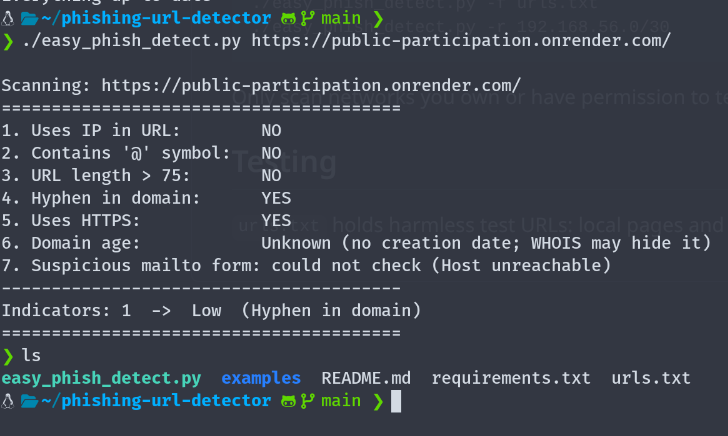
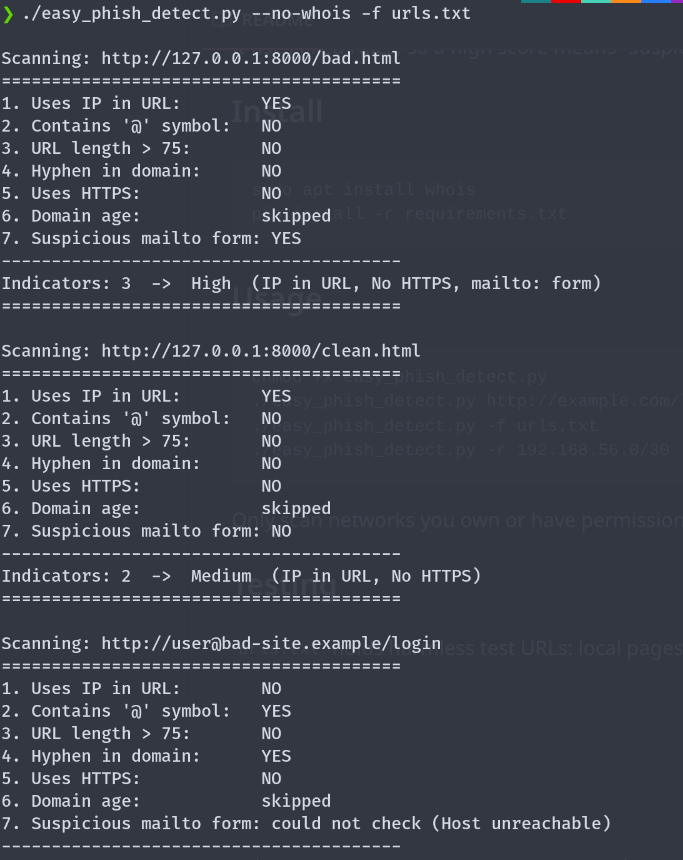
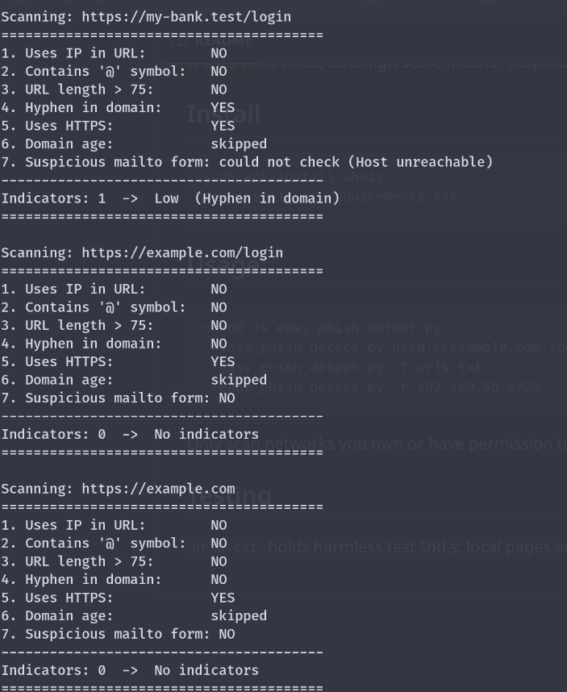

# Phishing URL Indicator Detector

A Python command-line tool that checks a URL for common phishing signs: an IP address instead of a domain, an `@` symbol, a very long URL, hyphens in the domain, no HTTPS, a `mailto:` form on the page, and a new or unregistered domain. It adds up the signs it finds and gives a risk level from none to high.

It handles timeouts, unreachable hosts and invalid URLs without stopping, and it can scan one URL, a list from a file, or an IP range.

It uses fixed rules, so a high score means "suspicious", not "proven malicious".

## Install

    sudo apt install whois
    pip install -r requirements.txt

## Usage

    chmod +x easy_phish_detect.py
    ./easy_phish_detect.py http://example.com/login
    ./easy_phish_detect.py -f urls.txt
    ./easy_phish_detect.py -r 192.168.56.0/30

Only scan networks you own or have permission to test.

## Testing

`urls.txt` holds harmless test URLs: local pages and reserved `.example` and `.test` domains.

## Example output

### 1. Risky URLs are flagged

The local test page `bad.html` scores **High**: it uses an IP address, has no HTTPS, and contains a `mailto:` form. The clean page `clean.html` scores **Medium** because it uses an IP address and plain HTTP, but the mailto check says `NO`. The URL with an `@` symbol and a hyphen is flagged, and the tool reports "Host unreachable" for the page check and keeps going.

### 2. Clean URLs give no false alarm

`https://my-bank.test/login` scores **Low**, because only the hyphen is flagged. `https://example.com` scores **No indicators**.

### 3. Scanning a real website

A real hosted site scores **Low**, with only the hyphen in the domain flagged. The domain age shows "Unknown" because WHOIS did not return a creation date, which does not prove the domain is new.
